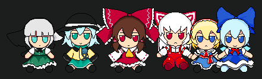
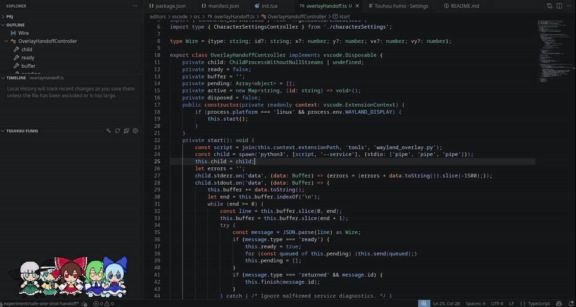
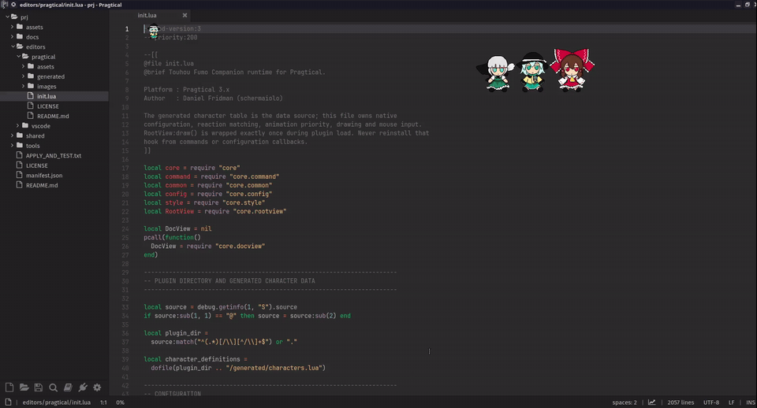
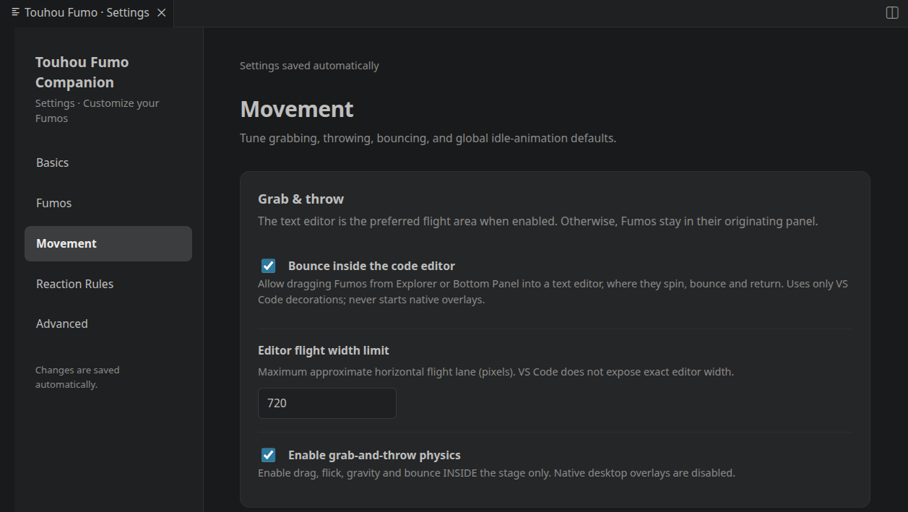
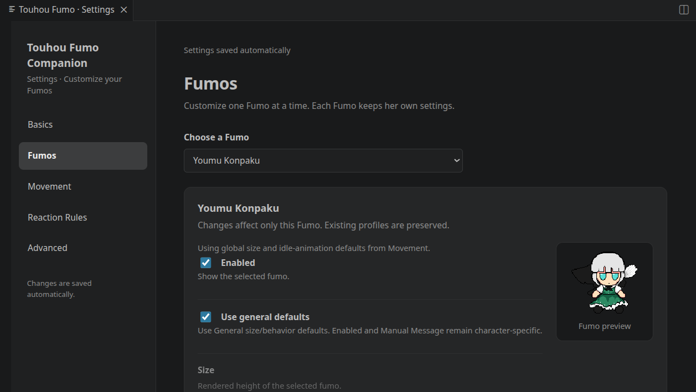
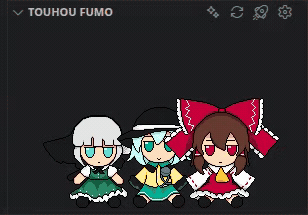

# Touhou Fumo Companion

<p align="center">

[](https://en.touhouwiki.net/)
[](https://github.com/schermaiolo/touhou-fumo-companion)
[](LICENSE)

</p>

<p align="center">

[](https://marketplace.visualstudio.com/items?itemName=schermaiolo.touhou-fumo-companion)
[](https://open-vsx.org/extension/schermaiolo/touhou-fumo-companion)
[](https://github.com/pragtical/plugins/pull/47)

</p>

Reactive Touhou fumo companions for **VS Code**, **Open VSX / Code-OSS compatible editors**, and **Pragtical**.

<p align="center">
  
</p>

Animated fumos can react to editor events, spin, perform character-specific animations, and be configured independently.

- [VS Code documentation](editors/vscode/README.md)
- [Pragtical documentation](editors/pragtical/README.md)
- [Architecture](docs/architecture.md)

---

## New features — Grab, throw, and customize!

No new Fumo this time. Instead, the whole crew has learned a few new tricks.

- **VS Code: Throw your Fumos across the editor!** Grab and flick a Fumo from the Explorer or Bottom Panel, with gravity and bouncy landings. Optionally enable **Bounce inside the code editor** to send her flying through your code before she returns home.
- **Pragtical: Grab & throw too!** Drag a stage Fumo around the Pragtical window, flick to launch, and watch her bounce before returning home. Enabled by default on fresh installs, with ordinary click reactions still intact.
- **VS Code: A friendlier Settings page.** Customize everything in one place, with clear **Basics**, **Fumos**, **Movement**, **Reaction Rules**, and **Advanced** tabs — including a sprite preview for each Fumo. Changes are saved as you make them.

In VS Code, open **Touhou Fumo Companion: Open Settings → Movement → Grab & throw**. Both physics options start disabled. In Pragtical, **Grab & Throw** is enabled by default for new installations and can be disabled under **Settings → Plugins → Touhou Fumo Companion**.

**VS Code drag-and-throw demonstration:**

<p align="center">
  
</p>

**Pragtical grab-and-throw demonstration:**

<p align="center">
  
</p>

**New VS Code settings:**

| Movement | Individual Fumos |
| :---: | :---: |
|  |  |

---

## Install

### Visual Studio Code

[](https://marketplace.visualstudio.com/items?itemName=schermaiolo.touhou-fumo-companion)

Install **Touhou Fumo Companion** directly from the Visual Studio Marketplace.

### Open VSX / Code-OSS

[](https://open-vsx.org/extension/schermaiolo/touhou-fumo-companion)

Install the extension from the **Open VSX Registry** for compatible editors using the Open VSX ecosystem.

### Pragtical

[](https://github.com/pragtical/plugins)

Install **Touhou Fumo Companion** through the official Pragtical Plugin Manager:

```bash
ppm install touhou_fumo_companion
```

---

## Feedback and fumo requests

Bug reports, feedback, animation ideas, and **requests for new fumos** are welcome through GitHub Issues.

<p align="center">
  
</p>

---

## Credits

Big thanks to **ZUN** for creating Touhou Project and its world.

Special thanks to **@Tim_M** ([itch.io](https://tim-m.itch.io/)) for the base fumo pack used as the starting point for this project, you can find them at https://fumofumos.com/.

So, starting from the base idle fumo: animation ideas, additional animation frames, and the rotation/spin views were created and edited manually by me, pixel by pixel. Building the animated turnaround sets was a long manual process.

Help on fixing them/adding new ones is always welcome!


---

## License

Source code and original documentation are released under the [MIT License](LICENSE). 

Touhou Fumo Companion is an unofficial fan project and is not affiliated with or endorsed by Team Shanghai Alice, ZUN, Gift, Visual Studio Code, Microsoft, or the Pragtical project.

The MIT license in this repository applies to the project source code and original documentation. It does **not** automatically grant rights to Touhou character names/designs, third-party trademarks, or artwork derived from third-party material.