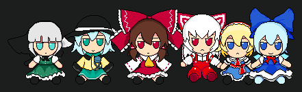
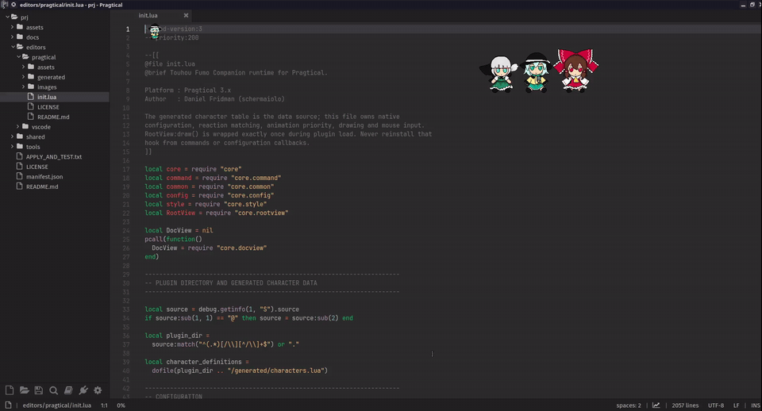
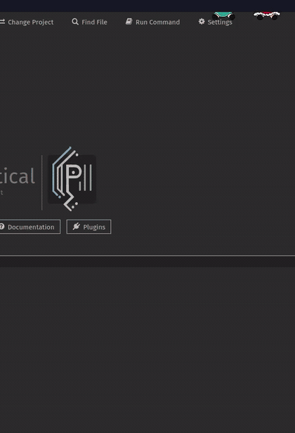
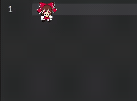
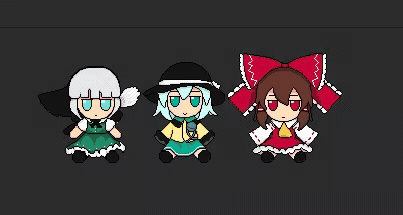
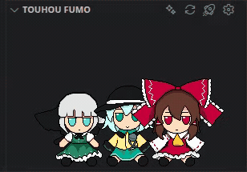

# Touhou Fumo Companion — Pragtical

**Source version:** `2.0.0`.

Reactive Touhou fumo companions for Pragtical, with native settings, stage animations, editor reactions, and a small cursor-following Editor Pet.

Feedback, bug reports, animation ideas, and **requests for new fumos are welcome**.

<p align="center">
  
</p>

---

## Features

- Multiple enabled characters on the stage.
- **Grab & Throw** physics (enabled by default for new installations): pick up a stage Fumo, flick her across the Pragtical window, bounce, and return home. Ordinary clicks still trigger manual reactions.
- Optional small Editor Pet near the active cursor/line.
- Per-character size and behavior settings.
- Click/manual reactions with configurable messages.
- Typing, newline, save, exact-text, and custom reaction rules that can be added to generate specific behavior from the fumo.
- Unique animations, normal spin, crazy spin, blink, and software movement (hops).
- Priority presets for competing animations.
- Spin-capable and non-spin characters can coexist safely.

---

## Current characters

- Youmu Konpaku
- Koishi Komeiji
- Reimu Hakurei
- Seija Kijin
- Sanae Kochiya
- Reimu Hakurei — Lost Word
- Fujiwara no Mokou
- Alice Margatroid
- Cirno

Default manual messages include:

- Youmu — `Myon!`
- Reimu — `Donate plz`
- Koishi — `Do you see me?`

An empty manual message keeps the animation but suppresses the bubble.

---

## Fumos in action

Here are a few examples of the animations and interactions. More reactions are available through the plugin's rules and per-Fumo settings.

### Grab & throw

Grab a stage Fumo from her usual spot, flick her across the Pragtical window, and watch her bounce before returning home. This works **out of the box** on fresh installs. A normal click still triggers the Fumo's manual reaction.

<p align="center">
  
</p>

### Animation gallery

| Crazy spin | Editor Pet |
| :---: | :---: |
|  |  |

| Click reactions | Typing reactions (VS Code example) |
| :---: | :---: |
|  |  |

*The typing-reaction GIF was recorded in VS Code; Pragtical also supports configurable typing and newline reactions.*

---

## Installation for development

From the repository root:

```bash
mkdir -p ~/.config/pragtical/plugins/touhou_fumo

rsync -avc --delete \
  editors/pragtical/ \
  ~/.config/pragtical/plugins/touhou_fumo/
```

Restart Pragtical completely after modifying the plugin.

---

## Settings

Open:

```text
Settings → Plugins → Touhou Fumo Companion
```

The settings page exposes general defaults, **Grab & Throw** (on by default for new installations), a selected-character configuration proxy, Editor Pet controls, and reusable reaction-rule slots. Dragging works only on stage Fumos; the Editor Pet remains click-to-react.

---

## Commands

Release-facing Pragtical commands include:

- `touhou-fumo:toggle`
- `touhou-fumo:react`
- `touhou-fumo:spin`
- `touhou-fumo:crazy-spin`
- `touhou-fumo:custom-reaction-1`
- `touhou-fumo:custom-reaction-2`
- `touhou-fumo:custom-reaction-3`
- `touhou-fumo:custom-reaction-4`

---

## Feedback and fumo requests

Bug reports, feedback, animation ideas, and **requests for new fumos** are welcome through GitHub Issues

---

## Credits

Big thanks to **ZUN** for creating Touhou Project and its world.

Special thanks to **@Tim_M** ([itch.io](https://tim-m.itch.io/)) for the base fumo pack used as the starting point for this project, you can find them at https://fumofumos.com/.

So, starting from the base idle fumo: animation ideas, additional animation frames, and the rotation/spin views were created and edited manually by me, pixel by pixel. Building the animated turnaround sets was a long manual process.

Help on fixing them/adding new ones is always welcome!


---

## Runtime note

`RootView:draw()` is wrapped exactly once during plugin load. Commands never reinstall the draw hook. Mouse hit-testing and the Editor Pet reuse the same plugin-owned runtime state.

---

## Architecture

See the repository-level [Architecture](../../docs/architecture.md).

---

## License

Source code and original documentation are released under the [MIT License](LICENSE). 

Touhou Fumo Companion is an unofficial fan project and is not affiliated with or endorsed by Team Shanghai Alice, ZUN, Gift, Visual Studio Code, Microsoft, or the Pragtical project.

The MIT license in this repository applies to the project source code and original documentation. It does **not** automatically grant rights to Touhou character names/designs, third-party trademarks, or artwork derived from third-party material.
