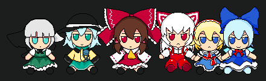
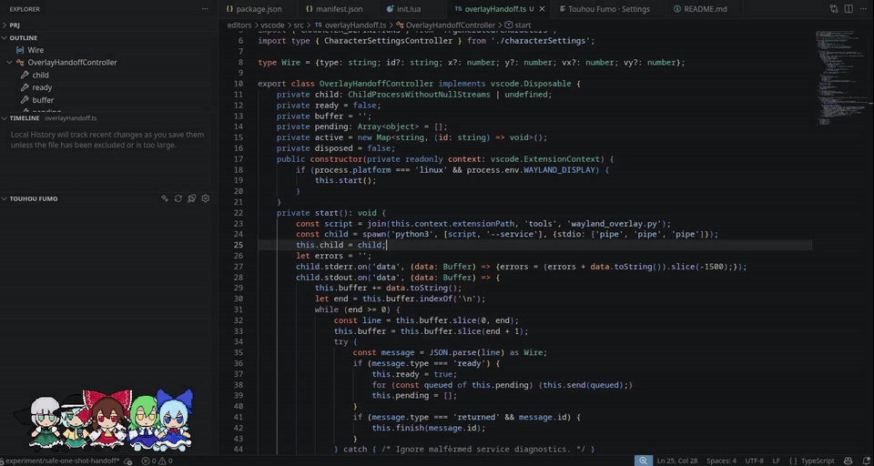
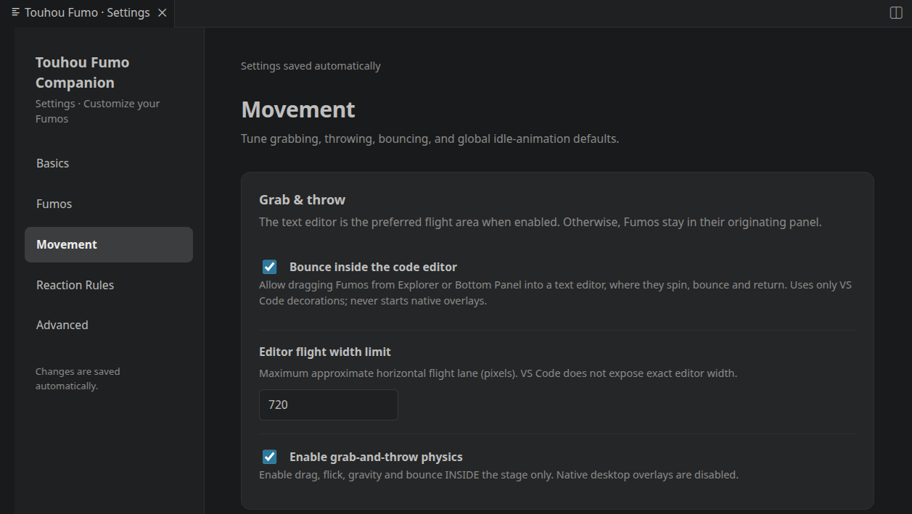
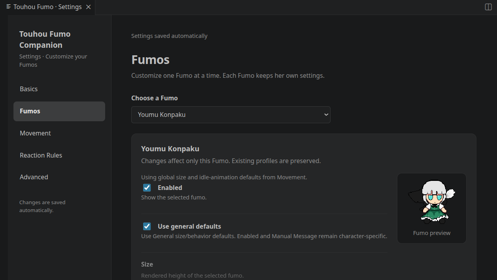
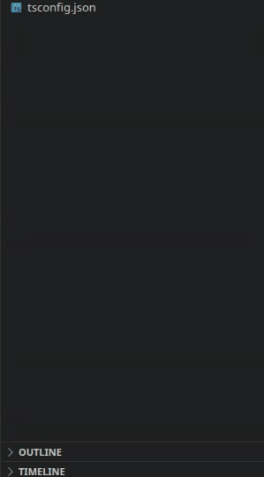
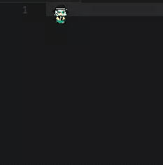
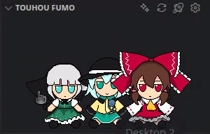
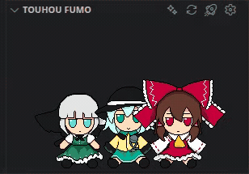

# Touhou Fumo Companion — VS Code

Reactive Touhou fumo companions for VS Code, with character-specific animations, editor reactions, configurable behavior, and multiple display surfaces.

**Source version:** `2.0.0`.

Feedback, bug reports, animation ideas, and **requests for new fumos are welcome**.

  

---

## New features — Grab, throw, and customize!

No new Fumo this time. Instead, the whole crew has learned a few new tricks.

- **Throw your Fumos across the editor!** Grab and flick a Fumo from the Explorer or Bottom Panel, with gravity and bouncy landings. Optionally enable **Bounce inside the code editor** to send her flying through your code before she returns home.
- **A friendlier Settings page.** Customize everything in one place, with clear **Basics**, **Fumos**, **Movement**, **Reaction Rules**, and **Advanced** tabs — including a sprite preview for each Fumo. Changes are saved as you make them.

Open **Touhou Fumo Companion: Open Settings** and visit **Movement → Grab & throw** to enable the physics features. Both grab-and-throw and editor flight are optional and disabled by default.

  

| Movement settings | Fumo-specific settings |
| :---: | :---: |
|  |  |

---

## Features

- Multiple independently configurable Touhou fumos.
- Explorer sidebar stage.
- Integrated bottom-panel stage.
- Large Coding Session below the source editor.
- Small Editor Pet near the active line.
- Grab-and-throw physics, with gravity and bouncing in the Explorer and Bottom Panel.
- Optional editor flight: throw a Fumo into your code and watch her bounce back home.
- Click/manual reactions with per-character messages.
- Typing, newline, save, build, debug, exact-text, and custom reaction rules.
- Blink, software movement (hops), unique animations, normal spin, and crazy spin.
- Priority presets so manual/editor reactions win over lower-priority random behavior.
- Characters without optional spin frames are handled safely and simply do not spin.

---

## Current characters

- Youmu Konpaku
- Koishi Komeiji
- Reimu Hakurei
- Fujiwara no Mokou
- Alice Margatroid
- Cirno
- Seija Kijin — no spin
- Sanae Kochiya — no spin
- Reimu Hakurei — Lost Word — no spin

Default manual messages include:

- Youmu — `Myon!`
- Reimu — `Donate plz`
- Koishi — `Do you see me?`

Leave a character's manual message empty to keep the animation while suppressing the speech bubble.

---

## Fumos in action

A few of the animations and reactions your Fumos can perform. There are plenty more to discover!

### Drag & throw

Grab a Fumo, flick her, and watch her bounce! Enable editor flight to send her through your code and back home.

See the drag-and-throw recording under **New features** above.

| Crazy spin | Editor Pet |
| :---: | :---: |
|  |  |

| Click reactions | Writing reactions |
| :---: | :---: |
|  |  |

---

## Commands

The following commands are available:

- **Touhou Fumo Companion: React Selected Fumo**
- **Touhou Fumo Companion: Spin Selected Fumo**
- **Touhou Fumo Companion: Crazy Spin Selected Fumo**
- **Touhou Fumo Companion: Open Settings**
- **Touhou Fumo Companion: Start Coding Session**
- **Touhou Fumo Companion: Close Coding Session**
- **Touhou Fumo Companion: Move Coding Session Below**
- **Touhou Fumo Companion: Run Custom Reaction 1–4**

The Explorer and Bottom Panel title buttons expose the same React, Spin, Crazy Spin, and Settings actions.

---

## Settings

Use **Touhou Fumo Companion: Open Settings** for the dedicated settings page. Changes are saved automatically, and most settings take effect without restarting VS Code.

- **Basics** — choose the Explorer stage, Bottom Panel, Coding Session, or Editor Pet.
- **Fumos** — select and customize each Fumo, with a sprite preview and optional per-Fumo overrides.
- **Movement** — adjust grab-and-throw physics, optional editor flight, and global animation defaults.
- **Reaction Rules** — customize coding events, animations, speech bubbles, and which Fumos react.
- **Advanced** — tune animation priorities and access the native VS Code settings.

To throw Fumos, enable **Enable grab-and-throw physics** under **Movement → Grab & throw**. To allow them to bounce through your code, also enable **Bounce inside the code editor**. Both options are off by default.

See the Movement and Fumos screenshots in **New features** above.

---

## Feedback and fumo requests

Bug reports, feedback, animation ideas, and **requests for new fumos** are welcome through GitHub Issues.

If you create or improve animation frames, contributions are welcome as well.

---

## Credits

Big thanks to **ZUN** for creating Touhou Project and its world.

Special thanks to **Tim_M** ([itch.io](https://tim-m.itch.io/)) for the base fumo sprite pack used as the starting point for this project. You can find the original collection at [fumofumos.com](https://fumofumos.com/).

Animation ideas, additional animation frames, and the rotation/spin views used by this project were created and edited manually by me, pixel by pixel. Building the animated turnaround sets was a long manual process.

Help with improving existing sprites and adding new fumos is always welcome.

---

## License

Source code and original documentation are released under the [MIT License](LICENSE).

Touhou Fumo Companion is an unofficial fan project and is not affiliated with or endorsed by Team Shanghai Alice, ZUN, Gift, Visual Studio Code, Microsoft, or the Pragtical project.

The MIT License in this repository applies to the project source code and original documentation. It does **not** automatically grant rights to Touhou character names/designs, third-party trademarks, or artwork derived from third-party material.